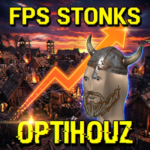

  

<h1 align="center">OptiHouse ⚡</h1>

  <b>High-Performance Client-Side Base Optimization Mod for Valheim</b> 
  <i>Eliminates massive framerate drops in large player bases, villages, and castles with zero risk to game worlds.</i>

  
  
  
  

---

### 🛡️ Zero-Risk Guarantee (No World or Structure Corruption)
Unlike destructive mods that merge or delete GameObjects and corrupt Valheim's persistent ZDO database (`.db` / `.fwl`), **OptiHouse operates 100% on the client presentation layer**:
- **Zero ZDO modifications:** Pieces are never deleted, baked into new GameObjects, or desynchronized.
- **Save files remain 100% vanilla:** You can safely install or uninstall OptiHouse at any time with zero impact on your saved worlds.
- **Zero Collider Interference:** Building piece colliders are **never** touched or disabled, guaranteeing 100% `WearNTear.UpdateSupport()` stability.
- **Hammer Safety:** Equipping a hammer or building tool instantly restores all culled detail renderers for pixel-perfect snapping and repairing.

---

**OptiHouse** is a client-side performance optimization mod engineered to eliminate framerate drops, stuttering, and render lag in large Valheim bases, villages, and mega-castles. 

When hundreds of building pieces, torches, braziers, smoke puffs, tamed animals, trophies, banners, and crafting stations meet in one area, Valheim's rendering and physics pipeline bottlenecks your GPU and CPU with thousands of unculled shadow draw calls, redundant particle bursts, physics vertex calculations, and excessive indoor smoke raycasts. **OptiHouse** smartly optimizes these subsystems without altering building integrity, fire mechanics, or core gameplay visuals.

---

## 🚀 Key Features & Optimizations

### 💡 1. Dynamic Lighting, Shadow Cascades & Probe Management (`[Lighting]` & `[General]`)
- **Adaptive Mega-Base Shadow Cascades:** Automatically drops directional sun `QualitySettings.shadowCascades` from `4` to `2` inside dense mega-bases (`>= 2,500` pieces), cutting directional sun shadow draw calls by **50%** and restoring `4` cascades as soon as you leave!
- **9-Frame Time-Sliced Reflection Probes:** Eliminates `ReflectionUpdate`'s rhythmic 3-second stutter spike by spreading 6-face cubemap rendering across 9 frames (`IndividualFaces`), stripping probe shadows/micro-layers, and extending stationary indoor re-renders to `14s`.
- **Native Forward Point-Light Cap (`LightLod.m_lightLimit`):** Uses Valheim's built-in priority fading system to cap simultaneous active point lights (default: 28), cutting up to 50% of redundant `ForwardAdd` render passes in torch-lit castles.
- **Point Light Shadow Limiter:** Restricts active shadow-casting point lights to the closest sources (default: 6).
- **Torch & Sconce Shadow Stripping + `CheckEnv` Throttle:** Strips heavy dynamic shadows from small torches/sconces and throttles redundant `Fireplace.CheckEnv` terrain raycasts from 4s to 20s.
- **Distant `LightFlicker` Culling:** Pauses CPU flicker math beyond 20m or behind camera (automatically defers to VPO if installed).

### 💨 2. Indoor Smoke Physics & Puff Throttling (`[Smoke]`)
- **Smoke Puff Hard Cap:** Enforces a configurable cap on simultaneous active smoke particles (default: 25 vs vanilla's 100+). Prevents massive chimney bottlenecks and physics lag while keeping hearths functional.
- **Ceiling Collision Throttling:** Throttles continuous indoor raycasting for rising smoke puffs to save CPU cycles.
- **Optional Smoke Rendering Toggle:** Option to disable visual particle rendering while fully preserving fire, warmth, cooking, and comfort mechanics.

### 💥 3. VFX & Particle Suppression (`[VFX]`)
- **Cultivation & Terraforming Throttle:** Suppresses repetitive, heavy particle bursts when cultivating soil, leveling ground, or using the hoe in base areas.
- **Demolition Dust Suppression:** Suppresses heavy debris chunk bursts and wood/stone dust particle spam when tearing down or rebuilding structures.
- **Zero Risk to Gameplay:** Does not affect item drops, resource yields, or damage indicators.

### 🏛️ 4. Structural CPU, True GPU Instancing & Shadow Optimizations (`[Structural]` & `[General]`)
- **True Hardware GPU Instancing + `MaterialMan` Bugfix:** Enables `Material.enableInstancing = true` across shared prefabs AND fixes two vanilla Iron Gate bugs that break instancing: clears empty C++ `MaterialPropertyBlock`s left behind after Hammer hover (`MaterialMan.UpdateBlock`), and prevents `RandomMaterialValues` (`RandMatSeed`) from breaking `DrawMeshInstanced` on Grausten, Black Marble, and Ashwood castles.
- **`ZSyncTransform` Sleeping Physics & Under-Floor Grass Culling:** Throttles per-frame C++ sync checks on sleeping `Rigidbody` network objects by 16x and suppresses invisible/clipping `ClutterSystem` grass tufts directly underneath base floors and stone foundations.
- **WearNTear Support Equilibrium Cache:** Fixes Valheim's ground/foundation support cache-miss bug — skips redundant `Physics.OverlapBoxNonAlloc` sweeps once structure support reaches 100% vanilla equilibrium, instantly invalidating on any build, break, terrain dig, rock mine, or tree chop.
- **Non-Ashlands `WearNTear` Loop Skip & Cover Throttling:** Skips `WearNTearUpdater`'s wasted per-second `UpdateAshlandsMaterialValues` iteration outside Ashlands and real-time throttles storm `UpdateCover` raycasts.
- **Small Prop Shadow Culling, Warehouse `Sign` UI Culling & Ornamental Detail LOD:** Disables shadows on distant small props (>18m), hides world-space `Sign` Canvases beyond 16m/behind camera (stopping 2s UGC permission spam), and culls ornamental micro-pieces beyond 38m while keeping **100% of walls, floors, pillars, and roof/ridge tiles solid**.
- **100% Structural Support Guarantee:** OptiHouse strictly preserves all physics colliders on all building pieces.

### 🚪 5. Smart Interior Occlusion Culling (`[Interior Occlusion]`)
- **Enclosed Furniture Occlusion:** Suppresses renderers of enclosed distant furniture, chests, and decor beyond 26m while **never** hiding walls, roofs, fireplaces, or light fixtures. Snapshots original renderer states for glitch-free restoration.

### ⚡ 6. Opt-In Engine Gfx Jobs Tweak (`[General]`)
- **boot.config Tweaks (Opt-In):** Vanilla Valheim already enables `gfx-enable-gfx-jobs=1`. OptiHouse leaves `boot.config` untouched by default; enabling `EnableGfxJobsTweak` opts in to injecting `gfx-enable-native-gfx-jobs=1` with a `.bak` backup.

### 🚩 7. Cloth & Banner Physics Culling (`[Cloth & Banners]`)
- **Unity Cloth Solver Culling:** Dynamically pauses heavy CPU vertex physics solvers on distant banners, flags, and tapestries beyond the culling distance (default: 15m).
- **Hysteresis Smoothing:** 3m hysteresis margin prevents rapid toggling when moving near the boundary; simulations smoothly resume when approaching.

### 📦 8. Storage & Trophy Stand Throttling (`[Storage & ItemStands]`)
- **Item & Armor Stand Throttling:** Mounted glowing weapons (Frostner, Mistwalker, torches) and trophies pause particle systems and disable dynamic point lights when beyond the culling threshold (default: 15m), safely restoring original states up close.
- **Instant Restore:** Automatically restores full visual brilliance when walking up to inspect items or stands.

### 🐗 9. Farm Animal LOD & AI Throttling (`[Farm Animals]`)
- **Tamed Animal Animator LOD:** Switches animators on distant tamed boars, wolves, chickens, and loxes in pens to `CullUpdateTransforms` beyond distance (default: 18m).
- **Idle AI Throttling:** Safely throttles stationary, calm pen animal AI from 20 Hz to 5 Hz without interfering with walking, breeding, taming, or combat defense.

### 🔨 10. Crafting Station & Beehive Culling (`[Crafting Stations]`)
- **Processing Station & Beehive Culling:** Pauses heavy particle emitters and looping ambient sound sources on smelters, blast furnaces, kilns, cauldrons, fermenters, spinning wheels, windmills, and beehives beyond distance (default: 20m).

### 📊 11. Real-Time Benchmark HUD Overlay (`[HUD & Benchmark]`)
- **In-Game Diagnostics (`Shift+F7`):** High-contrast, flicker-free IMGUI overlay displaying real-time FPS, rolling Average FPS, true 1% Low framerate, and frame time in milliseconds.
- **Live Base Diagnostics:** Displays total base pieces, active/capped point lights, shadow lights, prop shadow culling, WearNTear/Fireplace CPU loop skips, smoke puffs, banner cloths, item stands, tamed animals, stations & beehives, interior occlusion, detail LOD, sleeping ground loot, and Gfx Jobs status.
- **Status Indicator:** Shows live `[OptiHouse: ACTIVE]` (green) or `[OptiHouse: DISABLED]` (red) status.
- **Customizable:** Change hotkey, anchor position (`TopLeft`, `TopRight`, `BottomLeft`, `BottomRight`), and text size.

### ⌨️ 12. Runtime Toggle Hotkey
- **Instant Toggle (`F7` by default):** Switch optimizations on and off in real time with an on-screen HUD message to easily benchmark before-and-after FPS in your base.

---

## ⚙️ Configuration

A configuration file is generated at `BepInEx/config/com.unclebug.optihouse.cfg` upon first launch. All settings can be tweaked live in-game using the BepInEx Configuration Manager (F1).

| Category | Setting | Default | Description |
|---|---|---|---|
| **[1. General]** | `MasterOptimizationEnabled` | `true` | Master switch for all OptiHouse base optimizations. |
| **[1. General]** | `ToggleHotkey` | `F7` | Hotkey to toggle optimizations on the fly. |
| **[1. General]** | `ShowNotificationOnToggle` | `true` | Show on-screen MessageHud notification when toggling. |
| **[1. General]** | `EnableLogging` | `false` | Enable detailed diagnostic logging in BepInEx console. |
| **[1. General]** | `EnableGfxJobsTweak` | `false` | Opt-in: inject `gfx-enable-native-gfx-jobs=1` into `boot.config`. |
| **[2. Lighting]** | `EnableLightOptimization` | `true` | Enable dynamic base lighting and shadow management. |
| **[2. Lighting]** | `MaxActivePointLights` | `28` | Max active Forward-rendered point lights (`LightLod.m_lightLimit`, `0` = unlimited). |
| **[2. Lighting]** | `MaxShadowCastingLights` | `6` | Maximum number of point lights allowed to cast real-time shadows near the player (0–32). |
| **[2. Lighting]** | `DisableTorchShadows` | `true` | Disable shadow casting on small wall torches and sconces. |
| **[2. Lighting]** | `LightCullDistance` | `45.0` | Maximum distance at which small interior lights are actively processed (meters). |
| **[2. Lighting]** | `ThrottleFireplaceEnvChecks` | `true` | Throttle `Fireplace.CheckEnv` terrain raycasts from 4s to 20s. |
| **[2. Lighting]** | `CullDistantLightFlicker` | `true` | Skip CPU `LightFlicker` trig updates beyond 22m (defers to VPO). |
| **[3. VFX]** | `EnableVfxOptimization` | `true` | Enable particle and visual effect throttling. |
| **[3. VFX]** | `EnableFastParticleFade` | `true` | Accelerate particle dissipation cleanly once per effect. |
| **[3. VFX]** | `ParticleLifetimeMultiplier` | `0.45` | Multiplier for temporary particle lifetime. |
| **[3. VFX]** | `MaxParticleLifetimeSeconds` | `2.5` | Maximum seconds any temporary effect burst can exist. |
| **[3. VFX]** | `ParticleSimulationSpeed` | `1.5` | Speed multiplier for particle animations so dust and sparks disperse rapidly. |
| **[3. VFX]** | `SuppressCultivationParticles` | `true` | Suppress heavy particle bursts when hoeing or cultivating ground. |
| **[3. VFX]** | `SuppressDestructionParticles` | `true` | Suppress massive building demolition dust/debris spam. |
| **[3. VFX]** | `VfxThrottlingDistance` | `30.0` | Distance beyond which ambient dust/sparks/ash particles are throttled. |
| **[4. Smoke]** | `EnableSmokeOptimization` | `true` | Enable indoor smoke puff and physics optimization. |
| **[4. Smoke]** | `MaxActiveSmokePuffs` | `25` | Hard limit for simultaneous active smoke puffs in base areas. |
| **[4. Smoke]** | `SmokeLifetimeMultiplier` | `0.4` | Multiplier for chimney and hearth smoke puff lifetime. |
| **[4. Smoke]** | `ThrottleSmokeRaycasts` | `true` | Throttle indoor ceiling collision checks for smoke puffs. |
| **[4. Smoke]** | `DisableSmokeRendering` | `false` | Disable smoke particle visuals while keeping fire/comfort mechanics. |
| **[5. Structural]** | `EnableStructuralOptimization` | `true` | Enable structural piece shadow and CPU raycast optimizations. |
| **[5. Structural]** | `EnableWearNTearThrottling` | `true` | Throttle periodic rain/weather roof raycasts on intact pieces. |
| **[5. Structural]** | `WearNTearThrottleInterval` | `10.0` | Real seconds between weather cover raycasts for intact pieces during storms. |
| **[5. Structural]** | `SkipNonAshlandsMaterialUpdates` | `true` | Skip `WearNTearUpdater` per-second Ashlands shader loops outside Ashlands. |
| **[5. Structural]** | `EnablePieceShadowCulling` | `true` | Disable shadow casting on small structural elements beyond culling distance. |
| **[5. Structural]** | `PieceShadowCullDistance` | `18.0` | Distance beyond which small structural pieces stop casting shadows. |
| **[6. Cloth & Banners]** | `EnableClothOptimization` | `true` | Pause Unity Cloth physics on distant banners/flags. |
| **[6. Cloth & Banners]** | `BannerClothCullDistance` | `16.0` | Distance beyond which cloth physics simulation is disabled. |
| **[7. Storage & ItemStands]** | `EnableItemStandOptimization` | `true` | Pause particles and lights on distant mounted trophies and weapons. |
| **[7. Storage & ItemStands]** | `ItemStandCullDistance` | `15.0` | Distance beyond which item stand particles and lights are culled. |
| **[8. Farm Animals]** | `EnableTamedAnimalLod` | `true` | Enable animator LOD culling and idle AI throttling for distant tamed animals. |
| **[8. Farm Animals]** | `TamedAnimalLodDistance` | `18.0` | Distance beyond which tamed animal animators switch to LOD mode. |
| **[9. Crafting Stations]** | `EnableStationOptimization` | `true` | Pause particles and looping audio on distant crafting stations & beehives. |
| **[9. Crafting Stations]** | `StationCullDistance` | `20.0` | Distance beyond which station idle particles and audio pause. |
| **[10. HUD & Benchmark]** | `EnableBenchmarkHUD` | `true` | Enable the real-time in-game benchmark and diagnostics overlay. |
| **[10. HUD & Benchmark]** | `BenchmarkHudHotkey` | `F7` | Hotkey to toggle the benchmark HUD overlay. |
| **[10. HUD & Benchmark]** | `BenchmarkHudRequireShift` | `true` | Require holding Shift with hotkey (Shift+F7) to toggle the benchmark HUD. |
| **[10. HUD & Benchmark]** | `HudTextSize` | `13` | Font size for benchmark HUD overlay text (10–24). |
| **[10. HUD & Benchmark]** | `HudPosition` | `TopLeft` | Screen anchor position (`TopLeft`, `TopRight`, `BottomLeft`, `BottomRight`). |
| **[11. Interior Occlusion]** | `EnableInteriorCulling` | `true` | Enable enclosed interior furniture/chest culling beyond distance. |
| **[11. Interior Occlusion]** | `InteriorCullDistance` | `26.0` | Distance (in meters) beyond which enclosed furniture is culled. |
| **[11. Interior Occlusion]** | `EnableSmartInteriorCulling` | `true` | Keep distant enclosed rooms culled even when inside another room. |
| **[12. Terrain Helpers]** | `EnableTerrainSanityCheck` | `true` | Detect legacy uncompressed terrain modification stacks in base zones. |
| **[13. Item Drops & Loot]** | `EnableItemDropOptimization` | `true` | Sleep settled ground item Rigidbodies and pause distant sparkles. |
| **[14. Structural Detail LOD]** | `EnableDetailPieceLOD` | `true` | Cull ornamental micro-pieces (carvings, crosses, 1m poles) beyond distance. |
| **[14. Structural Detail LOD]** | `DetailPieceCullDistance` | `38.0` | Distance beyond which ornamental micro-details are culled. |

---

## 🛠️ Installation

### Thunderstore Mod Manager (Recommended)
1. Install [Thunderstore Mod Manager](https://www.overwolf.com/app/Thunderstore-Thunderstore_Mod_Manager).
2. Search for **OptiHouse** and click **Download**.

### Manual Installation
1. Ensure [BepInExPack Valheim](https://thunderstore.io/c/valheim/p/denikson/BepInExPack_Valheim/) is installed.
2. Download `OptiHouse_v2.1.0.zip` from Thunderstore or GitHub Releases.
3. Extract `OptiHouse.dll` into your Valheim directory under `BepInEx/plugins/UncleBugDev-OptiHouse/`.
4. Launch the game!

---

## 🌐 Compatibility & Multiplayer

- **Client-Side Only:** OptiHouse only runs on the client. It does **not** need to be installed on dedicated servers.
- **Server Friendly:** Safe to use on vanilla servers, community servers, and modded servers.
- **Mod Compatibility:** Fully compatible with Valheim+, ComfyQuickTransfer, PingMaker, PlantEasily, Gizmo, and other popular building mods.

---

## 🌟 Special Thanks & Credits

This mod was created and optimized thanks to the streamer **DaymonMontage**!

- 🎮 **Twitch Channel:** [twitch.tv/daymonmontage](https://www.twitch.tv/daymonmontage)
- 🌐 **Daymon Community Hub:** [daymonmontage.github.io/daymon-site/](https://daymonmontage.github.io/daymon-site/)

---

## 📜 License & Authors

- Author: **UncleBug** ([GitHub](https://github.com/UncleBugDev))
- Special Thanks & Inspiration: **DaymonMontage** ([Twitch](https://www.twitch.tv/daymonmontage) | [Web Hub](https://daymonmontage.github.io/daymon-site/))
- Licensed under the [MIT License](LICENSE).
